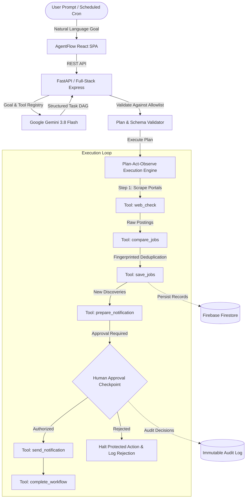

# AgentFlow: A Multi-Agent AI Automation Platform
> **From Prompts to Action** — An Autonomous Multi-Agent AI Automation Platform with Plan-Act-Observe Execution Loops and Human-in-the-Loop Safeguards.
>
> *Final-Year University Capstone Project — MIT-WPU*

---

## 1. Project Overview

**AgentFlow** is an AI-powered workflow automation platform that converts a user's natural-language goal into an executable sequence of steps. Built around an explicit **UNDERSTAND → PLAN → ACT → OBSERVE → APPROVE → CONTINUE → COMPLETE** execution cycle, the system leverages Google Gemini for task decomposition while enforcing strict backend isolation and human authorization checkpoints before executing sensitive external side effects.

The primary demonstration use case is an **Automated Career Portal & Internship Tracker** that monitors company portals (Google Cloud, Datadog, HashiCorp, Cloudflare) for newly posted Cloud Engineering and DevOps roles, deduplicates listings using fingerprint hashing, and prepares an executive email digest for review.

---

## 2. Problem Statement & Proposed Solution

### The Problem
Traditional automation workflows (e.g., Zapier, cron scripts) require brittle manual configuration for each step and cannot reason over unstructured text or dynamically adjust to evolving goals. Conversely, unconstrained LLM agent frameworks often suffer from unpredictability, hallucinated tool invocations, security leaks, and lack of deterministic human oversight.

### The AgentFlow Solution
AgentFlow introduces a structured hybrid architecture:
1. **Gemini AI Planner**: Translates user prompts into a validated, typed Directed Acyclic Graph (DAG) of steps.
2. **Controlled Tool Registry**: The AI can only pick from a strictly audited allowlist of backend tools. Arbitrary code execution and direct system shell access are strictly barred.
3. **Plan-Act-Observe Execution Loop**: Each step passes structured state to dependent steps, observes telemetry, and bounds retries.
4. **Mandatory Human-in-the-Loop Approval**: Irreversible or external side effects (e.g. sending emails, modifying accounts) automatically pause execution until approved.
5. **Deduplication Engine**: Uses URL normalization and content fingerprinting to ensure idempotent execution.

---

## 3. Architecture



---

## 4. Technology Stack

- **Frontend**: React 19, TypeScript, Vite, Tailwind CSS, Lucide Icons.
- **Backend**: Python 3.10+, FastAPI, Pydantic v2, Uvicorn (with companion Node.js Express server for development).
- **AI Reasoning**: Google Gemini API (`gemini-3.8-flash`) via modern `@google/genai` SDK with JSON structured schemas.
- **Database & Storage**: Firebase Firestore for persistent records (workflows, runs, companies, job postings, approval requests).
- **Authentication**: Firebase Authentication with role-based dashboard protection.
- **Automation & Scheduling**: GitHub Actions scheduled cron workflows (`.github/workflows/scheduled_check.yml`).

---

## 5. Repository Structure

```text
agentflow/
├── backend/
│   ├── app/
│   │   ├── agents/
│   │   │   └── orchestrator.py    # Plan-Act-Observe orchestrator
│   │   ├── core/
│   │   │   └── config.py          # Environment settings
│   │   ├── schemas/
│   │   │   ├── workflow.py        # Pydantic models for DAG & steps
│   │   │   ├── job.py             # Company & job schemas
│   │   │   └── approval.py        # Human approval requests
│   │   ├── tools/
│   │   │   └── registry.py        # Controlled tool registry allowlist
│   │   └── main.py                # FastAPI application entry point
│   ├── tests/
│   │   └── test_api.py            # Unit tests for tools & validation
│   ├── requirements.txt           # Python dependencies
│   └── .env.example
├── src/
│   ├── components/
│   │   ├── Navbar.tsx             # Clean 3-zone top navigation bar
│   │   ├── Sidebar.tsx            # Responsive SaaS workspace navigation
│   │   └── NotificationToast.tsx  # Floating toast notifications
│   ├── context/
│   │   └── AppContext.tsx         # Global reactive state management
│   ├── pages/
│   │   ├── LandingPage.tsx        # High-conversion marketing landing page
│   │   ├── DashboardPage.tsx      # KPI counters and recent execution feed
│   │   ├── WorkflowBuilderPage.tsx# Natural-language AI prompt & plan editor
│   │   ├── ExecutionViewPage.tsx  # Live visual pipeline with step inspector
│   │   ├── JobTrackerPage.tsx     # Company monitor & discovered jobs table
│   │   ├── ApprovalCenterPage.tsx # Human checkpoint approval queue
│   │   ├── ExecutionHistoryPage.tsx# Searchable logs & telemetry
│   │   ├── WorkflowManagementPage.tsx# Active pipeline management
│   │   ├── AuthPage.tsx           # Authentication & user profile
│   │   └── SettingsPage.tsx       # Integration verification & health checks
│   ├── services/
│   │   └── api.ts                 # Typed client API integration layer
│   ├── types/
│   │   └── index.ts               # Core TypeScript definitions
│   ├── App.tsx                    # Layout shell & view switcher
│   └── main.tsx
├── firebase/
│   ├── firestore.rules            # User-isolated security rules
│   └── firestore.indexes.json
├── docs/
│   ├── architecture.md            # In-depth architectural design
│   ├── api.md                     # REST API endpoint documentation
│   └── deployment.md              # Deployment topologies
├── .github/
│   └── workflows/
│       └── scheduled_check.yml    # Twice-daily automated check cron
├── server.ts                      # Full-stack dev server & Gemini API proxy
├── vite.config.ts
├── package.json
├── .env.example
└── README.md
```

---

## 6. Quick Start & Installation

### Prerequisites
- Node.js 18+ (Node 20+ recommended)
- Python 3.10+ (for running the standalone FastAPI backend)
- Google Gemini API Key

### Option A: Run Full-Stack Development Server (React + Live API)

1. Clone repository and install npm packages:
   ```bash
   git clone https://github.com/vivekgaikwad/agentflow.git
   cd agentflow
   npm install
   ```

2. Copy environment file and configure keys:
   ```bash
   cp .env.example .env
   # Set GEMINI_API_KEY=your_key_here
   ```

3. Start development server:
   ```bash
   npm run dev
   ```
   Open `http://localhost:3000` in your browser.

---

### Option B: Run Standalone Python FastAPI Backend

1. Navigate to the backend folder:
   ```bash
   cd backend
   python3 -m venv venv
   source venv/bin/activate  # On Windows: venv\Scripts\activate
   pip install -r requirements.txt
   ```

2. Configure environment:
   ```bash
   cp .env.example .env
   ```

3. Launch Uvicorn server:
   ```bash
   uvicorn app.main:app --host 0.0.0.0 --port 8000 --reload
   ```
   View interactive Swagger documentation at `http://localhost:8000/docs`.

4. Run unit tests:
   ```bash
   pytest tests/
   ```

---

## 7. Key Features Implemented

1. **AI Workflow Builder**: Enter goals like *"Monitor tech companies for DevOps internships and prepare an email digest"*. Gemini synthesizes a structured sequence of steps mapped to backend tools with explicit dependency tracking.
2. **Visual Execution Pipeline**: Real-time progress through `GOAL → PLAN → ACT → OBSERVE → APPROVE → COMPLETE` with step-level input/output summaries.
3. **Approval Center**: Human-in-the-loop gate where outbound emails or sensitive actions pause execution until explicitly approved or rejected.
4. **Automated Job Tracker**: Monitored company careers URLs with keywords, location filters, manual trigger scans, and duplicate fingerprinting.
5. **Searchable Execution History**: Audit logs and telemetry with redacted secrets.
6. **Backend Health & Verification**: Instant integration self-tests via `GET /health`.

---

## 8. Security & Design Invariants

- **Anti-AI Slop**: No fake scorecards, no ornamental pulsing dots, no code-comment headings (`//`), zero-pill metadata discipline, and standard tabular numerals for all metrics.
- **Zero Secret Exposure**: API keys and service account credentials are strictly server-side.
- **Fail-Safe Approvals**: Rejecting an action strictly halts the workflow and logs the reviewer's rationale.

---

## 9. Contributors & Academic Context

- **Student Developer**: Vivek Gaikwad (`vivek.gaikwad@mitwpu.edu.in`)
- **Institution**: MIT World Peace University (MIT-WPU)
- **Degree**: Bachelor of Technology in Computer Science & Engineering
- **Year**: 2026
