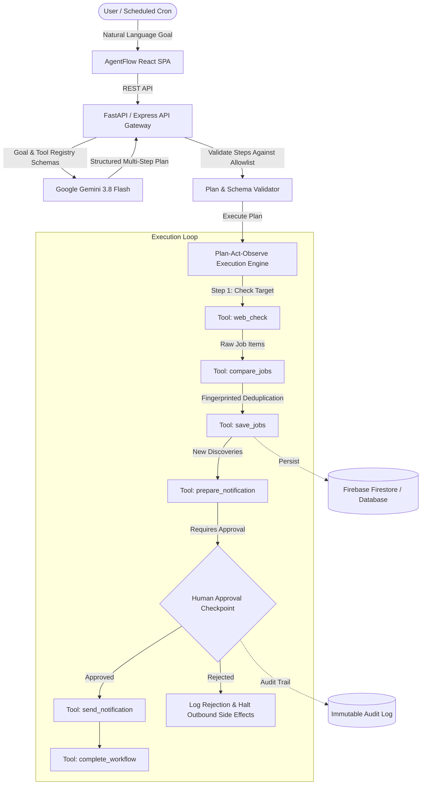

# AgentFlow: Architecture & System Design

## 1. System Overview

AgentFlow is an autonomous multi-agent automation platform converting high-level natural language user goals into validated, reproducible execution pipelines.

The platform couples Google Gemini AI reasoning with a deterministic backend tool execution sandbox and human-in-the-loop authorization gates.

## 2. Core Operational Cycle

AgentFlow strictly enforces the following 6-step lifecycle:

1. **UNDERSTAND**: Parses the natural language goal and optional parameters (keywords, company targets, locations).
2. **PLAN**: Prompts Google Gemini with the strict system tool registry schema. Gemini produces a typed JSON graph of steps with dependencies and approval flags.
3. **ACT**: The backend executes one eligible step at a time, invoking only registered tool implementations.
4. **OBSERVE**: Inspects tool results, verifies schemas, and logs observations into the audit trail.
5. **APPROVE**: If a step requires external side effects (e.g. sending emails or publishing data), execution pauses at an approval checkpoint. Only authorized human input can resume execution.
6. **COMPLETE**: Compiles final telemetry metrics and completes the run.

## 3. Security Boundaries & Invariants

- **Tool Isolation**: The AI planner can only select registered tools (`web_check`, `compare_jobs`, `save_jobs`, `prepare_notification`, `send_notification`, `complete_workflow`). It has zero access to arbitrary system commands, shell execution, or unvalidated network requests.
- **Secret Protection**: Gemini API keys, Firebase service account keys, and SMTP credentials remain strictly server-side.
- **Idempotency & Deduplication**: Discovered job postings are hashed by normalized URL and title to prevent duplicate database writes on repeated scans.
- **Immutable Audit Trail**: All actions, approvals, and rejections are preserved in the audit log for compliance.
